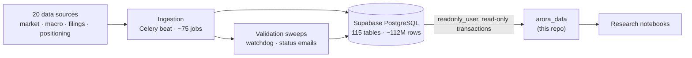
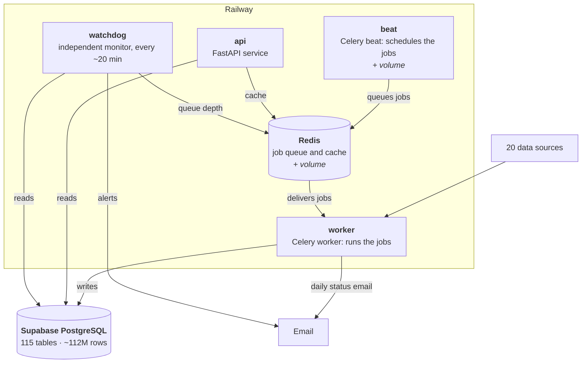
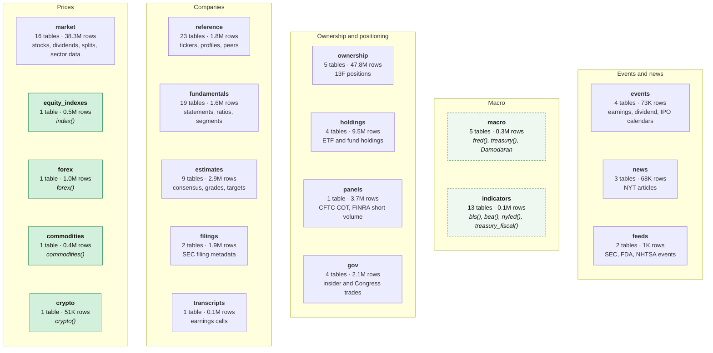

# arora_data

A typed, read-only Python function library that turns the AroraFund market-data platform into research-ready series:
Treasury curves, FRED, BLS and BEA macro data, New York Fed rates and Fed holdings, federal debt, FX, commodities,
crypto, equity indexes and Damodaran country risk.

```python
from datetime import timedelta
from arora_data.dates import today_et
from arora_data.sync import country_risk_premium, forex, fred, treasury_curve

week = today_et() - timedelta(days=7)

treasury_curve("4Y", week, method="monotone_convex")  # par yield and zero rate at 4 years, per day
fred("effective fed funds rate", week)                # by FRED id ("DFF") or by name, any case
forex("USD", "CAD", week)                             # daily FX bars
country_risk_premium("TUR")                           # the Damodaran edition in force today
```

## The platform behind it

AroraFund is a market-data platform I build and run on my own. Its ingestion code is private; this repository is the
research layer on top of it.

| | |
|---|---|
| Sources | 20, including FMP, FRED, SEC EDGAR, BLS, BEA, CFTC, FINRA, DBnomics, the NYT API and Damodaran |
| Storage | 115 tables in Supabase PostgreSQL, about 112M rows |
| Coverage | Equities, fundamentals, SEC filings, institutional positioning, FX, rates, commodities, macro and alternative data |
| Scheduling | About 75 daily and weekly jobs on Celery and Redis, with a FastAPI service |
| Data quality | Validation sweeps, an independent watchdog, and daily status emails on freshness and data quality |



### How it runs

Five services on Railway. `beat` puts each scheduled job on the Redis queue and `worker` runs it, writing to Supabase.
The `watchdog` runs on its own, so a stuck worker can't silence it: it checks the data's freshness and the queue's
depth, and emails an alert when either goes wrong.



### The database

115 tables in 19 schemas, about 112M rows (Postgres's own row estimates, November 2026). Green schemas are the
ones `arora_data` reads; a dashed border means it reads some of their tables so far (`macro` 4 of 5,
`indicators` 4 of 13).



## Functions

Every function is `async`; `arora_data.sync` has a blocking version of each for notebooks and scripts. Results are
pydantic models, and `arora_data.frames.to_df` turns a list of them into a Polars DataFrame.

| Function | Returns |
|---|---|
| `treasury(start, end=None, tenor=None)` | Treasury par yields by tenor, or every tenor |
| `treasury_curve(maturity, start, end=None, method="flat_forward")` | Par yield and zero rate at any maturity from 1M to 30Y |
| `fred(series, start, end=None)`, `fred_series()` | 120 curated FRED series, by id or name |
| `bls(series, start, end=None)`, `bls_series()` | BLS series, by id or name |
| `bea(series, start, end=None)`, `bea_series()` | Six BEA NIPA datasets, by id or name |
| `nyfed(series, start, end=None)`, `nyfed_series()` | New York Fed reference rates (SOFR, EFFR...) and the Fed's holdings by type, by id or name |
| `treasury_fiscal(series, start, end=None)`, `treasury_fiscal_series()` | Treasury's daily federal debt (Debt to the Penny) and its two parts, by id or name |
| `forex(base, quote, start, end=None)` | Daily FX bars for any currency pair |
| `commodities(base, start, end=None, quote="USD")` | Commodity bars, in USD or any FX currency |
| `crypto(base, start, end=None, quote="USD")` | Crypto bars, in USD or any FX currency |
| `index(base, start, end=None, quote=None)` | Equity index bars, as stored or in any FX currency |
| `sovereign_rating`, `sovereign_spread`, `country_risk_premium`, `equity_risk_premium` | Damodaran country risk data, each taking `(country=None, on=None, revision=None)` |
| `damodaran_editions()` | Every Damodaran edition and revision on record |
| `list_schemas()`, `list_tables()`, `list_columns()`, `list_series()` | A catalog of what the database holds |
| `check_fresh(series)` | Whether a series' latest point is recent enough for its frequency |

### Treasury curve methods

`treasury_curve` interpolates the stored par curve five ways:

| Method | How |
|---|---|
| `flat_forward` (default) | Bootstrapped zero curve with flat forwards between tenors |
| `monotone_convex` | Hagan-West monotone convex forwards, solved per day |
| `linear_par` | Linear interpolation on par yields |
| `cubic_par` | Natural cubic spline on par yields |
| `nss` | Nelson-Siegel-Svensson fit per day |

A method with a known weakness emits a `MethodWarning` on every call. For example, `nss` is a fitted curve and misses
the stored tenors, and `cubic_par` can overshoot between them.

## Design

- **Read-only by construction.** The only way into the database is `readonly_user`, through the transaction pooler,
  inside read-only transactions. The library refuses to connect under any other user.
- **Edition in force.** The Damodaran functions return the edition in force on a given date (`on=`), at its newest
  revision unless an earlier one is pinned with `revision=`. The newest revision can be one first seen after `on`,
  so this is not an as-known-then view.
- **Exact values.** Values come back as `Decimal`, as stored. Two curve methods, `monotone_convex` and `nss`, do
  their math in floats and return `Decimal`; the others stay in `Decimal` throughout.
- **Forgiving lookups.** Series, countries, commodities, coins and indexes match by id or name, ignoring case and
  extra spaces, and currencies by code in any case: `fred("DFF")`, `fred("dff")` and
  `fred(" effective FED funds rate ")` are the same call.

## Tests

436 tests in three layers:

- **Offline tests** (309) run against a mocked connection, so they need no database.
- **`tests/test_prod.py`** (127) runs small read-only checks against production when credentials are present, and
  skips otherwise.
- **`tests/mutation_check.py`** breaks one source line at a time and confirms that some test fails. It runs the offline
  tests first, so a caught mutation costs seconds.

## Notebooks

`notebooks/` has one notebook per reader, with outputs saved. They are the quickest way to see what each function
returns.

The FRED, BLS, BEA, New York Fed, Treasury fiscal and Damodaran notebooks show real data, run against production. The
FMP-sourced notebooks (forex, commodities, crypto, index, treasury and treasury_curve) show synthetic data: FMP's
license doesn't allow displaying its data publicly, so their outputs come from made-up data in
`notebooks/_synthetic.py`, run through the functions' own, unchanged code.

The New York Fed data in `function_nyfed.ipynb` stays under the New York Fed's Terms of Use at newyorkfed.org, not
this repository's terms, and the notebook carries its full notice. arora_data is not affiliated with the New York Fed.
The New York Fed does not sanction, endorse, or recommend any products or services offered by arora_data.

## Running it

The library reads from AroraFund's database, which is private, so running it needs read-only credentials that aren't
public.

```bash
pip install -e ".[dataframe,test]"
cp .env.example .env   # then set ARORA_READONLY_DSN
pytest
```

## License and use

You're very welcome to read the code and fork it on GitHub to explore it. If you'd like to use any of it in your
own work, or just talk about it, I'd be glad to hear from you at ansh.aro@outlook.com.
